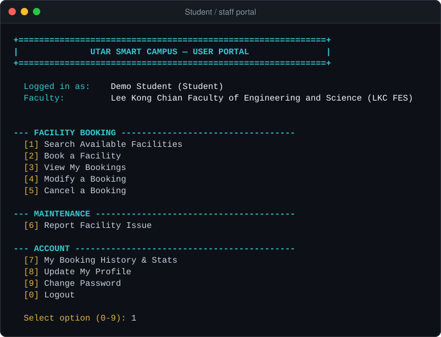
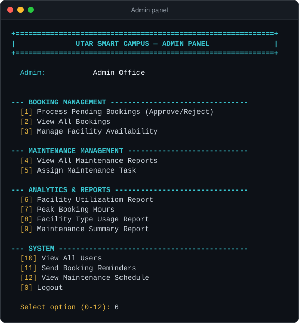
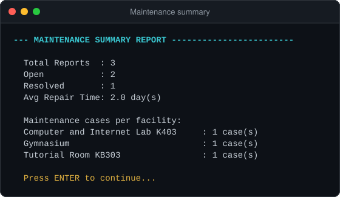
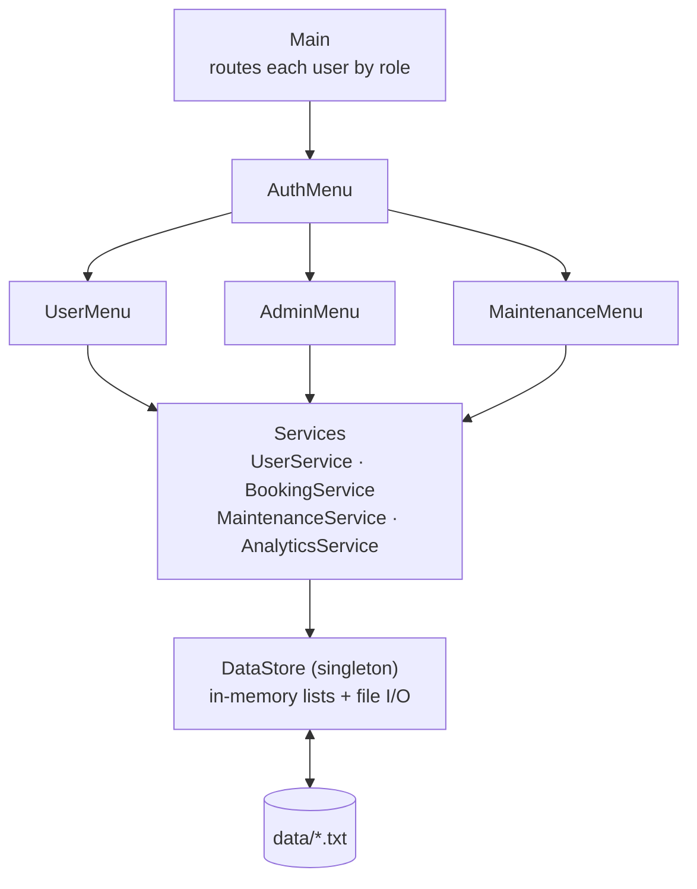
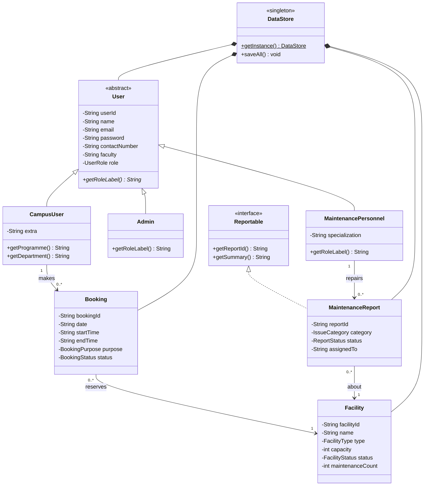

# Smart Campus Facility Booking & Maintenance System

A Java console application for booking campus facilities and tracking their maintenance at UTAR Sungai Long Campus. Students and staff search for free rooms, book them and report broken equipment. Admin staff approve bookings, assign repairs and read usage reports. All data is kept in plain text files.


<p align="center">
  
  
</p>

## About

This was a group project for **UECS1144 Object-Oriented Application Development** at Universiti Tunku Abdul Rahman (UTAR), Feb 2026 trimester. I led a team of four. The brief asked for an object-oriented Java system that uses `.txt` files as its database, is seeded with at least 20 UTAR users, and comes with a requirements specification and a UML class diagram.

The code is about 5,000 lines of plain Java with no frameworks or external libraries. It has 20 classes in four packages: `model`, `service`, `ui` and `util`.

## Features

**Students and staff**

- Register with a UTAR email address (`@utar.edu.my`), log in, update profile details and change password
- Search for free facilities by date, time slot and facility type
- Book a lecture hall, discussion room, computer lab, sports court or multipurpose hall for academic, co-curricular or official use
- Change a booking while it is still pending, or cancel it (up to 24 hours before it starts)
- Track each booking's status: Pending, Approved, Rejected or Cancelled
- Report a facility issue: damaged equipment, air-conditioning, furniture, electrical or other
- See a reminder on the menu when an approved booking starts within the next 2 hours
- View personal booking history and statistics

**Admin staff**

- Approve or reject pending bookings with a remark, with a warning if the slot overlaps an already approved booking
- Mark facilities as Available, Under Maintenance or Closed
- View maintenance reports, assign them to maintenance personnel and see the open-repairs schedule
- Get an alert when a facility has 3 or more unresolved issues
- Reports:
  - facility usage for all time, a month, a semester or a year
  - peak booking hours
  - bookings per facility type
  - maintenance summary (open vs resolved, average repair time, cases per facility)

**Maintenance personnel**

- View assigned tasks, mark them In Progress or Resolved with notes, and view completed work

## Screenshots

These are captured from the running program.

<p align="center">
  
  
</p>

<p align="center">
  
</p>

<p align="center">
  
</p>

## Booking rules

| Rule | Where it lives |
|---|---|
| A facility can't be double-booked. Two bookings on the same date clash when `start1 < end2` and `start2 < end1`; cancelled and rejected bookings don't count. | `BookingService.overlaps()` |
| Bookings must fall between 08:00 and 22:00 and last at least 30 minutes. | `InputValidator` |
| Dates must be real calendar dates in the current or next year. | `InputValidator.isValidDate()` |
| Only pending bookings can be changed. | `BookingService.modifyBooking()` |
| A booking can't be cancelled within 24 hours of its start time. | `BookingService.cancelBooking()` |
| Facilities that are under maintenance or closed don't appear in search and can't be booked. | `BookingService.searchAvailable()` |
| A reminder is shown once for each approved booking that starts within 2 hours. | `BookingService.getDueReminders()` |
| Admins are alerted when a facility has 3 or more unresolved maintenance reports. | `MaintenanceService.getFrequentIssueAlerts()` |

## Design

### Layers



- **`ui`** draws the menus, reads input and prints results. It holds no business rules.
- **`service`** holds the rules: conflict checks, the cancellation policy, reminders and analytics.
- **`model`** holds the domain classes: users, facilities, bookings and maintenance reports.
- **`util`** has `ConsoleUI` (colours, prompts, input retry) and `InputValidator` (email, phone, date and time checks without regex).

### OOP concepts used

| Concept | Where |
|---|---|
| Abstraction | `User` is an abstract class with the abstract method `getRoleLabel()`. `Reportable` is an interface. |
| Inheritance | `CampusUser` (student or staff), `Admin` and `MaintenancePersonnel` all extend `User`. |
| Polymorphism | Each subclass overrides `getRoleLabel()`. `DataStore` keeps every account in one `ArrayList<User>`, and `Main` opens a different menu for each role. |
| Encapsulation | All fields are private. Setters exist only for fields that are allowed to change; IDs have none. `MaintenanceReport.setAssignedTo()` also moves the status to `ASSIGNED`, so the two can't get out of sync. |
| Enums | `UserRole`, `FacilityType`, `FacilityStatus`, `BookingPurpose`, `BookingStatus`, `IssueCategory`, `ReportStatus` |
| Design pattern | `DataStore` is a singleton, so every service reads and writes the same data. |
| Exception handling | Services throw `IllegalArgumentException` or `IllegalStateException`, and the menus catch them and show the message. File I/O uses try-with-resources. A corrupt line in a data file is skipped instead of stopping the load. Number prompts retry on `NumberFormatException`. |

### Class diagram

A simplified view of the model:



The full UML class diagram the team drew for the assignment, with every attribute, method, multiplicity and visibility marker, is in [`docs/class-diagram.png`](docs/class-diagram.png).

## Getting started

You need JDK 17 or newer. There are no other dependencies.

```bash
git clone https://github.com/zijing0907/smart-campus-facility-booking.git
cd smart-campus-facility-booking
javac -d out --source-path src src/utar/Main.java
java -cp out utar.Main
```

The same commands work in Windows PowerShell. Use a terminal that shows ANSI colours, such as Windows Terminal, the macOS Terminal or the IntelliJ run window.

In IntelliJ IDEA, open the folder, mark `src` as the Sources Root, and run `utar.Main`.

On first launch the program creates a `data/` folder and fills it with the sample records from [`sample-data/`](sample-data). Every change is saved straight away. Delete `data/` to reset everything.

### Demo accounts

| Role | Email | Password |
|---|---|---|
| Admin | `admin@utar.edu.my` | `admin123` |
| Student | `student@utar.edu.my` | `pass123` |
| Staff | `staff@utar.edu.my` | `pass123` |
| Maintenance | `maintenance@utar.edu.my` | `pass123` |

The sample data has 26 users (16 students, 6 staff, 3 maintenance personnel, 1 admin) and 102 facilities modelled on the Sungai Long campus, plus a few bookings and maintenance reports. Every seeded account uses `pass123` except the admin.

## Data files

Each entity has its own pipe-delimited file, with one record per line and a `#` header line:

```text
# bookingId|userId|facilityId|date|start|end|purpose|desc|status|remark|reminderSent
BK0001|STU001|F001|20/04/2026|09:00|11:00|ACADEMIC|Project presentation|APPROVED|NULL|false
```

| File | Contents |
|---|---|
| `users.txt` | All accounts. The last column is the programme (student), department (staff) or specialisation (maintenance). |
| `facilities.txt` | Facilities with type, capacity, location, status and maintenance count |
| `bookings.txt` | Bookings with time slot, purpose, status and admin remark |
| `reports.txt` | Maintenance reports with category, status, assignee and dates |

`NULL` marks an empty value. A `|` or `\` typed by a user is stored as `\|` or `\\`, so free text can't break the columns.

## Project structure

```text
src/utar/
├── Main.java                  entry point: login loop and role routing
├── model/                     User (abstract), CampusUser, Admin, MaintenancePersonnel,
│                              Facility, Booking, MaintenanceReport, Reportable
├── service/                   DataStore, UserService, BookingService,
│                              MaintenanceService, AnalyticsService
├── ui/                        AuthMenu, UserMenu, AdminMenu, MaintenanceMenu
└── util/                      ConsoleUI, InputValidator
sample-data/                   seed records (same as a fresh data/ folder)
docs/                          class diagram and screenshots
```

## Fixed after submission

- **Records lost when text contained `|`.** The save code escaped `|` as `\|`, but the load code still split on it. A booking note like "Room A|B" was saved, then dropped without warning on the next start.
- **Hard-coded year.** Dates were only accepted for 2026, so searching and booking would have stopped working on 1 January 2027. Impossible dates such as 31/02 were also accepted.
- **Crash on end of input.** Pressing Ctrl+D (or Ctrl+Z on Windows) at a prompt crashed the program with a stack trace. It now exits cleanly.
